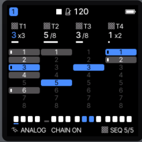
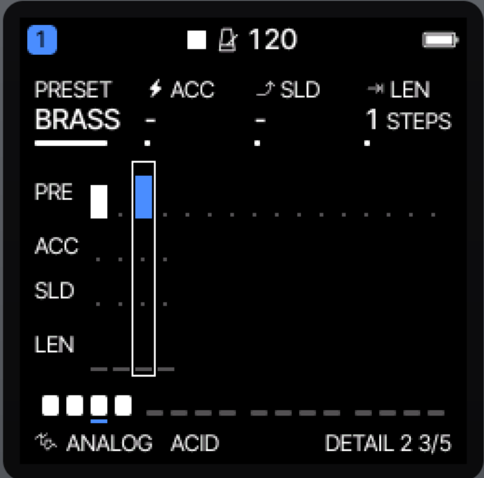
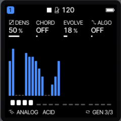
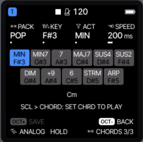

# Argo

## About this project

Argo is a multi-engine synthesizer firmware for the M-VAVE FM-1 that is built off of Felucca, removing the samples and adding in different engines.

To install this on the FM-1, first connect the FM-1 to a computer by USB, open the
[web installer](https://echoe.github.io/argo_fm1/) in Chrome or Edge, and press Install. No extra hardware is needed.

You can also try out this firmware by downloading the package and using it with [this web emulator](https://joakimeriksson.github.io/fm1-emu/?fw=local&mhz=100) .

I've tested this only on my own personal FM-1, so installing is at your own risk: M-VAVE's updater or the installer's **Return to official V15** should take you back to stock, or you should be able to flash another firmware after trying out this one.
You can also install locally using tools/fm1_install.sh. Details on how exactly to do that are in BUILDING.md.

NOTE: If you are worried about breaking your FM-1, I recommend installing [M-Bootloader](https://github.com/jvitkauskas/m-bootloader) to ensure you can boot to reflash your device if you have any issues!

- Install Argo: [web installer](https://echoe.github.io/argo_fm1/)
- Edit (upload patches, edit fm6 patches): [web editor](https://echoe.github.io/argo_fm1/webapp/editor/)
- Build: [BUILDING.md](BUILDING.md)
- Related projects that this uses:
- - [Felucca](https://github.com/hugelton/Felucca) (Where it all began, this firmware would not exist at all without it. I literally make releases in sync with the Felucca versions ... when I can/care.)
- - [Felucca-Engines](https://github.com/hugelton/Felucca-Engines) (the ANALOG, LOFI, TRIO, WHEEL, NOISE and PHASE engines, MIT; still maintained. Argo builds all but NOISE)
- - [felucca-bsp](https://github.com/hugelton/felucca-bsp) (the FM-1 hardware layer, MPL-2.0; Felucca, and by extension Argo, builds on it from 1.7.0)
- - [Mini-tone](https://github.com/eldontyrellcorp/Mini-Tone) (the SWARM, FM-TONE, and WAVETONE engines)
- - [Jiant](https://github.com/juanjiant-bit/JIANT) (the DRUM-X engine)

## Development and support

Argo is built almost entirely with free generative AI, piggybacking off of the work of Felucca. 

As is also true with Felucca, the
design, features, sound design and direction are the maintainer's or the community's, and no generative AI is used for music,
icons or artwork.

This README was initially written by AI as it edited the repo; it was then imperfectly hand-edited for clarity. If you see something that reads in a confusing way, please feel free to open an issue!

I am trying to not take making this firmware extremely seriously, because then it will run my life, and I have ... a job. So fixes/etc. may be slow. But if reported, I will fix bugs, think about suggestions, etc.

## Credits and license

In general, this entire project is GPL 3.0, as Felucca was/is.

Free software: [GPL-3.0-only](LICENSE); the Hügelton Sample Pack is CC0 1.0, but should be fully removed; the engines in `firmware/engines` are MIT

([Felucca-Engines](https://github.com/hugelton/Felucca-Engines)); the hardware layer in `firmware/bsp` is MPL-2.0

([felucca-bsp](https://github.com/hugelton/felucca-bsp)); the bundled fonts and ported DSP keep their own licences

([LICENSES/](LICENSES/), [LICENSING.md](LICENSING.md)). Additional engines are as listed in the overview.

Carried over from Felucca, thanks to everyone whose work and contributions are in Felucca as listed here: [CREDITS.md](CREDITS.md).

This includes the standard engines:

VOICE engine: after klattsch by Tony Gies (MIT); formant data from Klatt (1980) and Hillenbrand et al. (1995)

PHYS engine: models ported from DaisySP by Electrosmith and Emilie Gillet (MIT) and from Emilie Gillet's eurorack code (MIT)

FM6 engine: msfa from Dexed by Google Inc. and Pascal Gauthier (Apache-2.0)

M-VAVE and FM-1 are trademarks of their respective owners. Argo is not affiliated with or endorsed by them.

# The differences between this and Felucca

Argo is built off of Felucca, just with a few tweaks. The 'selling point' features are:

- Eight sequences per track that you can swap between live, and one sequence chain per track. This was the initial single change.
- Patch swapping per step [only within the same synth engine].
- A generative sequencer.
- Greatly expanded and playable chord modes.
- Different synth engines either from other firmware, or new, based off of the Nord Lead 2 and SH4d rhythm engine.
- Added tweaks to effects and general usage.
- No samples.

Pictures of the new features, which may be worth a thousand words:

     

We'll go through these in order.

## 8 sequences, one sequence chain option.

Each track plays one of eight sequences. A sequence has its own steps, its own length, and its own automation and parameter
locks (up to 64 records while it is not the one playing). DIV, SWING, GATE, QUANTIZE and the sound engine are set per track and you can't have different settings per sequence for them.
The page that shows this is at the end of the SEQ menu. The P1 - P4 knobs pick the sequence for each track that is both being played and edited: sequences are listed top-down.

- You can switch sequences either immediately when you change the sequence, or at the end of a sequence. This setting is at **MENU > CONTROL 2 > SEQ SWITCH**.
- To add or remove sequence chain on a sequence, turn the PRESETS knob. In general the PRESETS knob has been reused when sequences need anoter knob [it's also used for SONG mode]. Turn PRESETS right to add the selected pattern to the chain; turn it left to remove it from the chain. The sequences you chain play one after the other in order. A sequence that is not in a chain loops by itself.

  In the track it shows how many sequences the chain is under the track header (x2, x3, etc). Each sequence in a chain has a dot on its left that shows that it's a part of the chain. The bottom of the screen also shows "CHAIN ON" or "CHAIN OFF" for the selected track when you are on it [using the algorithm knob].
- To play different sequences in Song Mode, in the song mode ( click GLO ) the PRESETS knob changes the sequence that the selected cell plays. By default it'll play the sequence that the project was saved on, but you can choose any of the sequences within a track for it to play. It will display under the PAT option [knob 3]". The footer says what PRESETS does to hopefully remind you that you can do this. A song holds up to six such chosen sequences ("TOO MANY SEQ" is displayed otherwise) because of space limits. You can always play it in by hand if you need :)
- SAVE keeps all of a project's sequences, as well as the sequence that is playing at the time you save. Fun fast: this lives in the flash the user sample slots had, it's a lot more data.

## Preset changing per step

You can set a different preset per step, and this can change per sequence. The preset needs to be of the same synth engine as the track is set to, and it resets on every step. There is an upper limit of 64 changes per sequence so beware - if you want to make a lot of changes, you may hit that limit.
To do this in the easiest way, go to SEQ, choose your step [with K1], and then page to the DETAIL 2 page. You can then scroll through and select a preset, and see if different presets are set for the 16 steps SEQ is currently set to view. You can also change the current step you're selecting with PRESET in this mode.
If you prefer setting this in a list, you can also set the specific action individually on the 4th page of the SEQ menu, which lists all changes within the sequence.

## The generative arpeggiator

The arp mode has a new value at the end of the menu, GEN (Generative), and a page to control the generative settings. The track plays by itself if the FM-1 is playing.

NOTE/WARNING: Whether the arpeggiator is on or not doesn't affect the current sequence, so the generated notes will play at the same time as sequence notes if the sequence has notes in it.
Everything that affects the ARP also affects this generative mode - for instance, it only plays notes as set in the SCL mode you can access in the SEL button menu.

The GEN page has these knobs to control the randomization for the selected track:
- **DENS** (KNOB 1): Density - this controls how many note events are created. Turning it up adds notes to the same loop and turning it down takes them away; 0 plays nothing, 100 % makes a note on every step.
- **CHORD** (KNOB 2): This controls if the created notes are chords, and the amount controls how complex the chord is. 0 plays single notes, and from 1 a growing share of the steps are chords - all of the notes are chords from halfway through, but the odds are that they get fancier and fancier as you keep going, with chords getting more notes, etc.
- **EVOLVE** (KNOB 3): How much the loop changes after each play. 0 repeats it exactly; a little moves a few notes a step or two in the scale (now and then a new chance, chord or loudness); 100 % changes nearly every step each loop.
- **ALGO** (KNOB 4): The algorithm the generative engine uses to bias it to pick different notes. It starts with no algorithm (full randomness for every note within the other parameters). At 33% it has a 'Fifths' algorithm [playing only fifths], at 67% a 'Bounce' algorithm, and at 100% it's a 'DRUMS' algorithm Those algorithm settings are simply biased to hitting different notes differently.

- To change the length of the generated loop, you need to change the length of the underlying sequence. Hold SEQ and you can change LEN there - it only generates up to 32 steps though, at the arp's rate. Swing, Gate, and Probability apply too.
- The knobs are saved with the sequence banks (project SAVE, RESTORE LAST); the loop itself is made either when GEN starts or when a project loads, and simply pauses if you pause the FM-1.
- Record-arm a track to record the generated notes into the underlying sequence if it makes something you really like. You will probably want to disable the arpeggiator after that; otherwise the saved notes and the generated notes will play at the same time. With 8 sequences, though, you can also save a sequence and then switch to a new sequence, and save different generated patterns you like that way.

## Chord Improvements and modes

Multiple new chord-playing modes have been added to this firmware.

First off, the smaller change - there are three new CHRD options on page 2 of the SEL menu.
Two of them, **STR3** and **STR7**, use the black keys to select a chord and then let you play the white keys as the individual notes that work with that chord. The LLM describes it this way:

- **Black keys** (F#3 .. F#5, eleven) choose the chord and make no sound: the diatonic triad (STR3) or seventh (STR7) on the scale's
  1st, 2nd, 3rd ... degree (the track's ROOT and SCALE; a chromatic scale uses the major scale of ROOT), the keys past the scale's
  last degree the same chords an octave up. The chosen key lights, and the CHORD page names the chord ("G7").
- **White keys** (F3 .. G5, sixteen) are the strings of that chord: the chord's notes in order from the left, then the same an
  octave up, and so on, so sliding a finger over the keys strums up the chord, and a key held sounds its string until it is let go.
- **VOIC** voices the chord (CLOSE, OPEN, INV1, INV2, +OCT's bass string), **TRN** and the octave buttons move it. A MONO, LEGATO or
  UNISON part plays the strings one at a time. MIDI notes, the arp and kits (DRUM, slices) play as with CHRD OFF.

There is also a third new value for CHRD, **PLAY**, inspired by a popular chord engine VST. This is set on the third page of the SCL menu. Every white key plays its corresponding chord (EG: C plays a C chord), and the 
black keys that are held with it shape the chord. You can set what each black key does, and set it up to your liking.
With the built in POP pack, for example, keys are set like this: 
key 1 MIN, key 2 MIN7, key 3 7, key 4 MAJ7, key 5 SUS4, key 6 SUS2,
key 7 DIM, key 8 +9, key 9 6, key 10 STRM, key 11 ARP.
For example, with the above settings you can strum a minor 7 C chord by holding black key 1, 3, and 10, and then hitting the white C note. ... Or you can just hold key 2 and key 10.

The actions (lowest black key first, so a later one changes what an earlier one set: MIN then 7 is a minor seventh; 7, +9 and +11
stack), as listed by LLM:

- **quality** MIN, DIM, AUG, SUS2, SUS4, POW; **seventh** 6, 7, MAJ7, and MIN7, DIM7, M7B5, MMAJ7 (a quality with it); 9, MAJ9, MIN9
  (with the ninth); **extras** +9, +11, +13 (added tones), INV (the root up an octave), BASS (the root an octave down).
- **STRM**: the notes of the chord one after the other, low to high, held until the key is let go. How fast is the **SPEED** below.
- **ARP**: one note at a time, round the chord, at the track's ARP RATE and GATE, until the key is let go.
- Up to six tones: past that the fifth goes first, then the highest. VOIC voices the chord as it does the other chord modes.

To set the black keys to latch instead of needing to be held, toggle this with the PRESETS knob. With latch on, a black key pressed toggles its action on; a second press turns it off. The chord is made from the latched actions (a key still held does not count twice). LATCH settings are part of the pack, saved and loaded with it.

The other settings for this menu are:
KNOB 1 PACK, 2 KEY (which black key you're editing), 3 ACT (the action: what it does), 4 SPEED (for strum, 0..1000 ms between notes).
The page shows all eleven black keys so you can really go wild with setting this up.
Packs are what the black keys do and the strum speed together: six are built in (POP, JAZZ, SUS, EXT, EASY, HARP), and USER 1 through USER 4 can be changed and saved by the user. Turning KNOB 1 loads a pack at once (a "*" says it was changed since).
OCT+ saves what the black keys do into the user pack you pick.
The packs and the keys' setting are saved with the music (project SAVE, RESTORE LAST) in the sequence bank's flash.

## Six new synth engines; two unique to this firmware, four from other firmwares

The synths in common with Felucca are:

- ANALOG, FM6, PHASE, LOFI, VOCAL, TRIO, WHEEL, PHYS: default Felucca synths. (Felucca's NOISE engine is no longer built into Argo: LEAD took its engine slot, 11.)

Synths from other firmwares are:
- SWARM, FM-TONE, WAVETONE: Engines from the Mini-tone firmware, modeled after the Digitone II's synth engines.
- DRUM-X: A drum engine from the Jiant firmware, modeled after Microtonic.

The unique synths in this firmware are:
- LEAD: a two-oscillator subtractive synth loosely based off of Synth2's open-source reconstruction of the Nord Lead. The controls:
  - Two oscillators. The first one has Sine, Saw, Pulse, and Triangle; the second one drops Sine and adds Noise. Adjust pitch and detune as well.
  - Mix amount (from osc1 to osc2), Modulation (sync, ring, or both), and filter saturation.
  - FM amount (OSC 2 to OSC 1 phase modulation), SUB (the sub oscillator, an octave below OSC 1) and SUBW (its shape: Sine, Tri, Saw, Square), Keytrack (OSC 2 key tracking).
  - Filter: Types - Lowpass 12 and 24DB, Highpass 12DB, Bandpass 12DB, Lowpass Diode), Cutoff, Resonance, Key tracking.
  - Mod Envelope: Amount (-64..+63; 0 is off), Mod attack, Mod decay, Mod Destination (the envelope moves Oscillator 2's pitch by up to 60 semitones, the FM depth or the pulse width).
  - Pulse width is set with the track's Shape as adjusted in the ENV section's second page.
- SH-TONE: A drum engine unique to this firmware, loosely modeled after the SH-4d's drum engine. There is both a drum engine around this with several presets, and a synth engine where you can change every setting. The architecture is:
  - Two oscillators that can be either SIN, TRI, SAW, SQR, or NOISE.
  - You can either MIX, FM, RING, or SYNC the two oscillators at a DEPTH AMT.
  - Sweep pitch and time, and change the coarse pitch of each oscillator (TUN A, TUN B), making it easier to get a simple drum fast.
  - Individual AD envelope and level per operator.
  - Drive/Click/Fold/Crush end of chain effects.
  - An ending LP/BP/HP filter.

## Other non-effects changes

### Argo theme

There's a new theme just for this fork :) It's just salmon-colored.

### SELECT is set to PAGE by default

You can still change it in the menu, but it's set to page between pages by default. I hate clicking the button multiple times to page between them every time, so this default was changed.

### 48 user presets

We've removed the saved patterns from presets in order to have more space to add additional presets. 
Note: The last 16 presets can't hold FM6 patches. This is due to some weird patch rules with those patches specifically.

### EDIT: DEL STEP reminder when opening the sequencer menu

It's easy to forget that EDIT deletes a step within the sequencer, and nobody ever turns on the help menus. So now this help text flashes when you open the sequencer up. I am still feeling this change out - part of me wonders if just turning HELP on by default would resolve this - but I think it's fine for now.

## Effects changes

### USER Slicer setting on the SLICER 2 page

In FX, the SLICER has a USER pattern (PAT 17). On the SLICER 2 page the white keys toggle its 16 steps (the first key copies the preset you had
selected). There is one USER pattern per project, saved with it.
The keys still play notes so watch out if you're doing it live :)

### Additional INSERT effects

We've added a GRAIN effect and a TAPE effect. This is to make up for the GRANULAR engine being removed [because it needed samples as an input]. They're pretty simple, but still fun!

## That's it!
If you have any requests or suggestions, please feel free!
